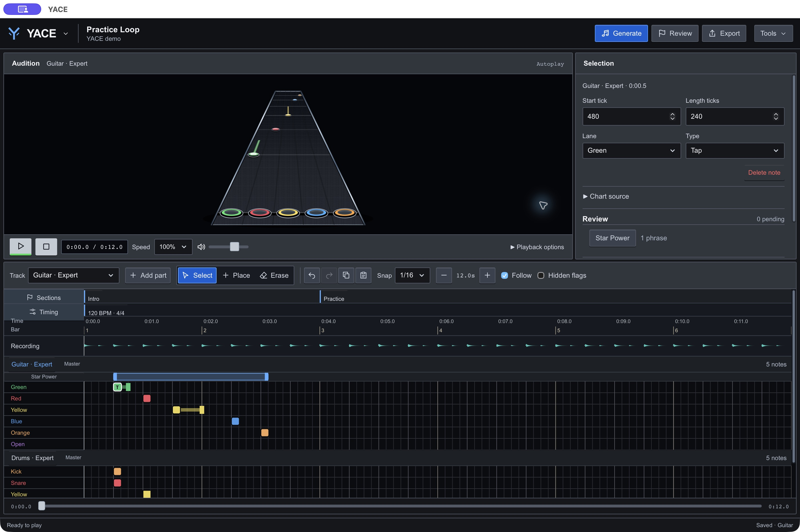

# YACE — Yet Another Charting Engine

A Rust chart editor for Clone Hero, YARG and Dance / 4-key charts.
Import audio, generate a draft, then listen and edit.

**[Open YACE in your browser](https://yace.n8bradshaw.com/)** · [User guides](docs/README.md) · [Build for desktop](#build-for-desktop)

**Generated charts need review.** Listen to each part and playtest your export
before sharing it. YACE is pre-release software.



## Make your first chart

1. **Start:** choose **Import audio** to generate a draft, or **New blank chart**
   to write notes yourself. Use **Import song ZIP** for an existing chart.
2. **Set up:** check song details, tempo and parts. Choose where to save.
3. **Review:** listen, fix notes and timing, and use Undo when needed.
4. **Export:** choose **Export playable song…** for your target game.

In Chrome and Edge, new projects default to a local folder. Firefox requires
an explicit **Use browser storage** choice. Browser saves stay in that browser
and profile; download a **complete project ZIP** to keep an independent backup.
A playable-song export and a project backup serve different purposes.

[Generation guide](docs/GENERATION.md) · [Editor guide](docs/EDITOR.md) · [Browser guide](docs/BROWSER.md)

## What can I chart?

| Parts or task | What YACE supports |
| --- | --- |
| Guitar, Bass, Drums | [Generate drafts and edit notes, timing and Star Power](docs/GENERATION.md) |
| Piano / Pro Piano | [Five-lane Keys and pitch-based Pro Keys](docs/PIANO.md) |
| Lead vocals | [Generate and edit pitches, words and phrases](docs/VOCALS.md) |
| Pro Guitar / Pro Bass | [Edit strings, frets and articulations; MIDI export, no automatic generation](docs/CLIENT_PARITY.md#pro-guitar-strings-and-frets-2026-11-08) |
| Dance / 4-key | [Generate, edit and export simfiles](docs/DANCE.md) |
| Stems and repairs | [Separate audio](docs/generation-isolation.md), [reanalyze one part or loop, then review before applying](docs/GENERATION.md#reanalyze-a-part) |

**Game support varies.** Clone Hero export excludes vocals, Pro Keys, Pro Guitar
and Pro Bass. Check the export dialog for compatible parts and formats.

Also available: [practice playback](docs/PRACTICE.md), an optional
[charting assistant](docs/AI_ASSISTANT.md), and
[collaboration through Git or shared files](docs/COLLABORATION.md).
Assistant edits require **Apply**. Hosted collaboration remains unfinished.

## Files, models and privacy

- **Audio processing runs locally.** The browser uses local workers; some native
  model runners are desktop-only. See [browser limits](docs/BROWSER.md).
- **Models download separately.** Missing-model downloads are optional and
  checked against pinned SHA-256 hashes. Some models have noncommercial or
  unresolved terms; check [THIRD_PARTY.md](THIRD_PARTY.md) before redistribution.
- **Optional online tools share context.** Lyric lookup sends song metadata to
  LRCLIB. The assistant sends text context to your chosen provider, without audio
  bytes. See [privacy and data](docs/PRIVACY.md).

## Build for desktop

You need **Rust, a C/C++ compiler, CMake and FFmpeg/ffprobe** on PATH.
The Rust version is pinned in `rust-toolchain.toml`. macOS is the tested desktop
platform; Windows and Linux need release testing. Native stem separation needs
a compatible GPU.

```sh
cargo run --locked --release
```

This builds and opens YACE. The Cargo package and executable are named
`chart-engine`. For an app bundle, see [macOS packaging](docs/PACKAGING.md).

<details>
<summary>Command line and model setup</summary>

```sh
cargo run --locked --release -- --help
cargo run --locked --release -- generation --help
cargo run --locked --release -- editor --help
```

Fetch and verify the complete default model catalogue only if you need it:

```sh
cargo run --locked --release -- models fetch
cargo run --locked --release -- models verify
```

For a build without the desktop window, separator or acoustic lyric aligner:

```sh
cargo build --locked --release --no-default-features
```

That build supports chart commands, supplied transcription data and full-mix
drum generation. It is not a model-free audio transcriber.

</details>

<details>
<summary>How YACE is made, contributing and licenses</summary>

<a href="https://0rwx.com/">
  <picture>
    <source media="(prefers-color-scheme: dark)" srcset="assets/0rwx/AI-X-dark.svg">
    
  </picture>
</a>

YACE follows the [0rwx **EXECUTE** (AI made) approach](https://0rwx.com/):
the project owner sets direction and evaluates results; AI handles implementation
and verification. The source is open to read, review and change.

Read [CONTRIBUTING.md](CONTRIBUTING.md) for checks and comment style,
or [deployment](docs/DEPLOYMENT.md) for hosting instructions.

YACE's original code is [MIT](LICENSE). Included components and models retain
their own licenses; see [THIRD_PARTY.md](THIRD_PARTY.md).

</details>
