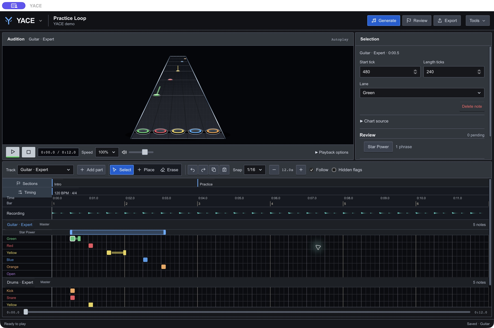
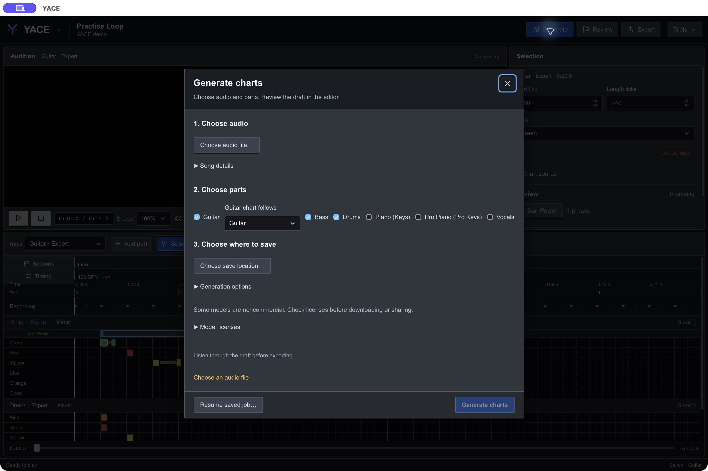

# YACE — Yet Another Charting Engine

A chart editor for Clone Hero and YARG, written in Rust.

Import a local recording, generate a draft, then listen and edit. YACE supports
guitar, bass, drums, Keys, Pro Keys and lead vocals. Generated parts need review;
they are not finished charts.

The [browser workflow harness](docs/BROWSER.md) uses the same Rust workbench with
browser audio, file uploads and downloadable song exports. It currently uses a
local LiveView host. The delivery target is a static Dioxus Web/WASM application.
The product target is faster, easier charting and reliable team work;
complete OCTAVE/Moonscraper parity and hosted collaboration remain unfinished.



Preview above, edit notes and Star Power below. Shown with a small demo chart.

<details>
<summary>Generating a draft from audio</summary>

Choose audio, choose parts, then pick a save location.



</details>

## Start here

**Requirements:** Rust, a C/C++ build toolchain, CMake, and FFmpeg/ffprobe on PATH.
The tested Rust toolchain is pinned in `rust-toolchain.toml`. macOS is the tested
desktop platform; Windows and Linux still need release testing. Stem separation
also needs a compatible GPU.

```sh
cargo build --locked --release
cargo run --locked --release
```

The desktop app opens when you run YACE without arguments. The executable and
Cargo package are named `chart-engine`.

1. Choose **Import audio** and select a local audio file.
2. Check the song information, tempo and instruments.
3. Generate into a new folder.
4. Listen to each part, edit the draft, then export a separate song folder.

For an existing chart, open its song folder as a new review project. YACE keeps
a source copy and saves edits with Undo/Redo.

See [generation and recovery](docs/GENERATION.md) or the [editor guide](docs/EDITOR.md)
for the full workflow.

## What you can do

| Task | Guide |
| --- | --- |
| Edit notes, Star Power, tempo and song sections | [Editor](docs/EDITOR.md) |
| Generate guitar, bass and drum drafts | [Generation](docs/GENERATION.md) |
| Edit five-lane Keys or pitch-based Pro Keys | [Piano and synth](docs/PIANO.md) |
| Edit vocal pitches, words and phrases | [Vocals](docs/VOCALS.md) |
| Solo stems and compare them with the original | [Stem playback](docs/generation-isolation.md) |
| Inspect timing and instrument evidence | [Part analysis](docs/PART_ANALYSIS.md) |
| Ask for advice and review suggested edits | [Charting assistant](docs/AI_ASSISTANT.md) |
| Exchange proposals through Git or shared files | [Collaboration](docs/COLLABORATION.md) |
| Make an editable clean-audio plan | [Clean versions](docs/CLEAN.md) |

The assistant is optional. Suggested edits require an explicit Apply action.
Editing and export work without an assistant connection.

## Models and network access

Transcription uses local models downloaded separately from the source. The app
can fetch missing models when you select that option. Downloads are checked
against pinned SHA-256 hashes.

To fetch the complete default catalogue from the command line:

```sh
cargo run --locked --release -- models fetch
cargo run --locked --release -- models verify
```

Models have separate licenses, including noncommercial restrictions and unresolved
checkpoint terms. Read [THIRD_PARTY.md](THIRD_PARTY.md) before redistributing them.
The macOS packager excludes model weights by default. Private local bundles can
opt in with `--include-models`; those assets need a separate redistribution review.
See [macOS packaging](docs/PACKAGING.md).

Optional lyric lookup sends song metadata to LRCLIB. Assistant requests send text
context to the provider you choose. Audio bytes are not sent by the assistant.
See [privacy and data](docs/PRIVACY.md) for details.

## Command line

```sh
cargo run --locked --release -- --help
cargo run --locked --release -- generation --help
cargo run --locked --release -- editor --help
```

For a build without the desktop window, separator or acoustic lyric aligner:

```sh
cargo build --locked --release --no-default-features
```

That build still supports chart editing commands, supplied transcription data,
and full-mix drum generation. It is not a model-free audio transcriber.

## Contributing

Read [CONTRIBUTING.md](CONTRIBUTING.md) for checks and comment style.
[The documentation index](docs/README.md) lists the user and contributor guides.

YACE is pre-release software. Listen to generated parts and playtest exports
before sharing a chart.

YACE's original code is MIT. Included components retain their own licenses;
see [LICENSE](LICENSE) and [THIRD_PARTY.md](THIRD_PARTY.md).
